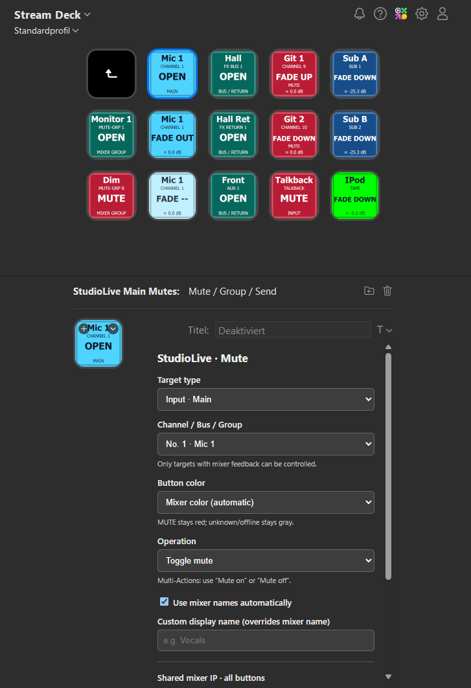

# StudioLive Control

StudioLive Control is a Stream Deck plugin for PreSonus StudioLive Series III mixers. It provides direct control of levels, fades, mutes and sends, with live state, names and colors from the mixer.

**Windows · macOS · Stream Deck 7.1+ · Version 1.0.0**

One installer serves Windows and macOS. The macOS test build was reported working on the user’s MacBook; see the [release notes](docs/RELEASE-1.0.0.md) for scope and migration from development builds.

[Get started](#get-connected) · [User guide](docs/USER-GUIDE.md) · [Changelog](CHANGELOG.md)

## Screenshot

Example layout with input, bus, mute-group, Tape and Talkback controls. The screenshot shows the earlier **StudioLive Main Mutes** category name; the current name is **StudioLive Control**.

## Features

| Control | What you can do |
|---|---|
| **Levels & fades** | Set a fixed level, adjust by a relative step, fade between −∞ and 0 dB, or stop a fade. |
| **Inputs & buses** | Select inputs 1–64, A1/A2, Tape, Talkback, Main, Sub, Mix buses and FX buses/returns. |
| **Mutes & sends** | Control target mutes, existing mute groups and individual input-to-Aux/FX send mutes. |
| **Button layout** | Follow live mixer names and colors, or choose your own display name and color per key. |

Available controls depend on the state your mixer provides. A target without valid feedback stays **UNKNOWN**. Find the exact ranges and behavior in the [user guide](docs/USER-GUIDE.md).

The plugin connects directly over the mixer's control network. The saved mixer address is shared across all buttons, folders and profiles; no separate bridge application is required.

## Development

Additional mixer functions are planned. The table above lists the currently implemented controls; changes are recorded in the [changelog](CHANGELOG.md).

## Get connected

You'll need **Windows 10 or 11**, or **macOS 13 or later**, **Stream Deck 7.1 or later**, and a mixer reachable on its **control network** via TCP port **53000**.

1. Install `de.local.studiolive-mutes.streamDeckPlugin` with Stream Deck running. Use a release asset if available, or [build it yourself](docs/PUBLISHING.md).
2. Add **Mute / Group / Send** or **Level / Fade** from the **StudioLive Control** category.
3. Enter your mixer IPv4 address and click **Save mixer IP for all buttons**. Wait for the save confirmation.
4. Choose a target and operation for the button.

Your address is remembered on this computer's user account. Existing profiles and button assignments remain compatible.

New **Level / Fade** buttons default to **Toggle fade −∞ / 0 dB** with a **3-second** transition. Its return level is always **0 dB**; displayed dB values are approximate. Existing saved operations and durations are retained. For a specific target level, choose **Set fixed level / Fade**.

## Compatibility

Read-only hardware checks used a **StudioLive 24 Series III** reporting **32 logical inputs**. Automated control tests cover 16-, 24-, 32- and 64-input simulators and the additional inputs. Real 64S and additional-input control-write acceptance are still open. See the [test report](TEST-REPORT.md) for the full scope.

This is an independent, unofficial project and is not affiliated with PreSonus or Elgato.

## Documentation

- [User guide](docs/USER-GUIDE.md) — setup, controls, colors and troubleshooting.
- [Build & publish](docs/PUBLISHING.md) — create an installer from source.
- [Architecture](docs/ARCHITECTURE.md) — connections, state and command handling.
- [Test report](TEST-REPORT.md) — verified behavior and hardware limits.

[MIT licensed](LICENSE). Protocol handling and the fader curve build on Andrew Wong's [StudioLive API](https://github.com/featherbear/presonus-studiolive-api). See [Third-party notices](THIRD_PARTY_NOTICES.md) for credits and dependency licenses.
